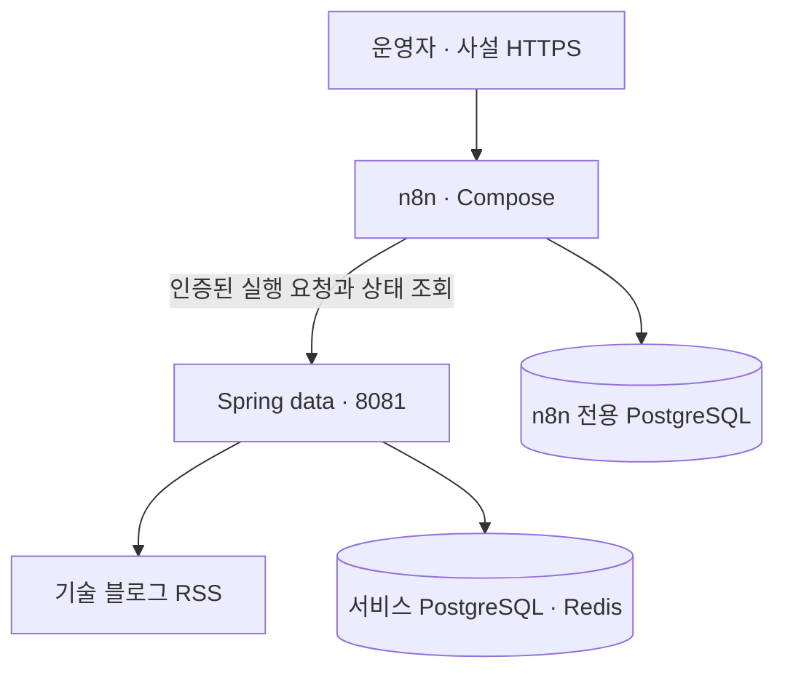

# data 모듈 n8n 도입 설계

기준 브랜치는 `develop`이고, 운영 배포 경로는 `main`의 `cd-data`도 확인했다. 목표는 n8n에서 데이터 작업의 실행 시각과 후속 처리를 관리하고, Spring `data`에서 수집·저장·캐시 갱신을 수행하는 것이다. 첫 적용 후보는 TechBlog RSS 수집이다.

## 현재 구조

| 확인한 코드 | 설계에 반영할 점 |
|---|---|
| [cd-data.yml](../../.github/workflows/cd-data.yml) | OCI ARM64 서버에서 `data`와 Redis를 Compose로 운영한다. 배포할 때 서버의 Compose 파일을 다시 생성하므로 서버에서만 추가한 네트워크 설정은 다음 배포 때 사라질 수 있다. |
| [TechBlogDataScheduler](../../data/src/main/java/com/services/data/techblog/scheduler/TechBlogDataScheduler.java) | RSS 수집은 매일 08:00·13:00·22:00, 게시물 물리 삭제는 00:05에 실행한다. 수집 일정만 전환 대상으로 잡는다. |
| [TechBlogInternalController](../../data/src/main/java/com/services/data/techblog/TechBlogInternalController.java), [TechBlogRssCollector](../../data/src/main/java/com/services/data/techblog/TechBlogRssCollector.java) | 수동 `POST /techblogs/collect`와 정기 스케줄이 같은 수집기를 별도로 호출한다. 수집 결과에는 피드별 성공·실패 건수가 있고, 두 진입점에서 각각 목록 캐시를 비운다. |
| [ApplyDaysInternalController](../../data/src/main/java/com/services/data/applydays/ApplyDaysInternalController.java), [SchedulingConfig](../../data/src/main/java/com/services/data/config/SchedulingConfig.java) | ApplyDays 통계 수동 실행은 텍스트 응답을 반환한다. 공통 `@EnableScheduling`을 끄면 다른 배치도 함께 멈추므로 전환 스위치는 TechBlog RSS 수집에만 둔다. |

## 구성과 배포

- 운영은 OCI Data 서버에서 **n8n 단일 인스턴스와 n8n 전용 PostgreSQL**을 별도 Compose 프로젝트로 띄운다. 둘의 DB 연결은 n8n 전용 네트워크를 사용한다. 초기 용량은 호스트 여유 메모리, 디스크, 기존 배치의 피크 사용량을 확인한 뒤 정한다. 이미지와 PostgreSQL 버전은 OCI의 `linux/arm64` 지원 및 보안 패치를 확인한 후 고정한다. [n8n Docker Compose](https://docs.n8n.io/deploy/host-n8n/install-options/install-using-docker-compose) · [지원 DB](https://docs.n8n.io/deploy/host-n8n/configure-n8n/choose-n8ns-database)
- 두 Compose 프로젝트는 사전에 만든 외부 브리지 `4d4cat-data-automation`을 공유한다. 기존 `cd-data.yml`이 생성하는 Compose에는 `data` 서비스만 이 네트워크에 붙이도록 기록하고, n8n에서는 `http://data:8081`로 호출한다. 첫 도입 때는 네트워크를 먼저 만든 뒤 두 스택을 배포한다. n8n과 n8n DB는 별도로 시작·중지하며, `data`의 시작 조건에 추가하지 않는다. [Docker Compose 네트워크](https://docs.docker.com/compose/how-tos/networking/)
- n8n의 포트는 호스트 루프백에만 바인딩하고 운영자용 사설 HTTPS 프록시로 접속한다. 편집기 URL을 해당 HTTPS 주소로 설정하고 프록시가 전달하는 헤더와 실제 프록시 홉 수를 맞춘다. 첫 오너 계정을 제한된 경로에서 생성하고 운영자 2FA를 적용한다. 파일·명령 실행 노드와 커뮤니티 노드 설치는 초기 배포에서 차단한다. 웹훅이 필요한 기능이 정해지면 별도 경로와 인증을 설계한다. [n8n 보안 설정](https://docs.n8n.io/hosting/configuration/environment-variables/security/) · [프록시 설정](https://docs.n8n.io/hosting/configuration/configuration-examples/webhook-url/)
- `cd-data`의 현재 Compose는 `8081`과 Redis `6379`를 호스트에 게시한다. 실제 OCI 방화벽과 Nginx 라우팅은 배포 전에 점검한다. 기존 Prometheus의 `/actuator/prometheus` 수집은 허용하되, 신규 실행 API와 기존 수동 트리거가 호스트 포트나 공개 프록시를 통해 우회 호출되지 않는지 확인한다. n8n 호출용 토큰은 허용한 작업에만 유효하게 하고 n8n Credential과 서버 비밀 설정에서 별도로 관리한다. SSRF 방어를 켜고 내부 HTTP 호출 예외는 `data` 호스트로 좁힌다. [n8n SSRF 방어](https://docs.n8n.io/deploy/host-n8n/configure-n8n/basic-configuration/use-environment-variables/ssrf-protection)
- 구현 시 `data/n8n/compose.yml`, `data/n8n/.env.example`, `data/n8n/workflows/`를 둔다. 이 경로는 현재 `cd-data`의 `data/**` 필터에 포함되므로 n8n 파일만 바뀌면 Java 재배포를 건너뛰도록 분리한다. n8n은 별도 수동 배포 워크플로우로 운영하고, PR에서는 샘플 변수로 `docker compose config`와 워크플로우 JSON을 검증한다. 워크플로우는 자격 증명 참조, 고정 헤더, 테스트 데이터 등을 정리한 뒤 Git에 넣고 환경별 Credential은 배포 시 연결한다. 최초 검증은 개발 환경에서 수행한다.

| 설정 | 초기 운영값 또는 기준 |
|---|---|
| 실행 모드와 시각 | `EXECUTIONS_MODE=regular`, `TZ=Asia/Seoul`, `GENERIC_TIMEZONE=Asia/Seoul`. TechBlog 워크플로우의 시간대도 동일하게 명시한다. |
| DB와 비밀 | `DB_TYPE=postgresdb`와 `DB_POSTGRESDB_*`로 전용 DB·계정 연결. 고정 `N8N_ENCRYPTION_KEY`와 DB 비밀번호는 n8n 전용 비밀로 주입한다. |
| 영속성 | PostgreSQL 데이터와 n8n `/home/node/.n8n`을 별도 볼륨에 둔다. DB·볼륨을 백업하고 암호화 키를 별도 비밀 저장소에서 함께 복구할 수 있게 한다. |
| 실행 기록 | `EXECUTIONS_DATA_SAVE_ON_SUCCESS=none`, `EXECUTIONS_DATA_SAVE_ON_ERROR=all`, `EXECUTIONS_DATA_SAVE_MANUAL_EXECUTIONS=false`, `EXECUTIONS_DATA_PRUNE=true`, `EXECUTIONS_DATA_MAX_AGE=168`부터 시작한다. 실패 시에도 저장될 수 있는 입출력은 실행 ID와 집계 수치 위주로 제한하고, 비밀·본문은 포함하지 않는다. |
| 상태 및 확장 | `/healthz/readiness`로 DB 연결·마이그레이션을 확인한다. 실행 대기와 호스트 자원 사용량을 측정한 뒤, 단일 인스턴스가 병목일 때 Redis와 워커를 쓰는 queue 모드를 검토한다. |

[n8n DB 변수](https://docs.n8n.io/hosting/configuration/environment-variables/database/) · [실행 기록 변수](https://docs.n8n.io/hosting/configuration/environment-variables/executions/) · [상태 확인](https://docs.n8n.io/hosting/logging-monitoring/monitoring/) · [백업과 복구](https://docs.n8n.io/deploy/host-n8n/keep-n8n-running/backup-and-restore) · [Queue mode](https://docs.n8n.io/hosting/scaling/queue-mode/)

## TechBlog 워크플로우와 내부 API

먼저 수동 트리거로 `GET /actuator/health`만 호출해 네트워크를 검증한다. 실제 수집은 다음 계약을 구현한 뒤 개발 환경에서 시작한다. 아래 두 경로는 신규 제안이다.

| 호출 | 동작 |
|---|---|
| `POST /internal/jobs/techblog-rss/runs` | 작업 전용 인증과 `Idempotency-Key`를 확인한다. 예정 시각을 전달하는 정기 요청과 별도 ID를 쓰는 수동 요청을 구분한다. 접수를 서비스 DB에 기록한 뒤 `202`와 실행 ID를 반환한다. 동일 요청이 재전송되면 기존 실행 ID를 반환하고, 동일 키에 다른 입력은 `409`로 거절한다. 다른 요청의 수집이 진행 중일 때도 `409`를 반환하되 충돌 코드를 구분한다. |
| `GET /internal/jobs/techblog-rss/runs/{runId}` | 인증 후 `PENDING`, `RUNNING`, `SUCCEEDED`, `PARTIAL_SUCCESS`, `FAILED`, `NEEDS_REVIEW` 중 하나와 집계 결과를 반환한다. 일부 피드가 실패하면 `PARTIAL_SUCCESS`, 모든 피드 실패나 작업 예외는 `FAILED`로 기록한다. |

1. n8n은 정기 실행 키를 `techblog-rss:<예정 시각의 UTC ISO-8601>` 형식으로 생성한다. 응답 유실이나 네트워크 타임아웃이 발생하면 같은 키를 재사용한다. Spring의 정기 실행과 장애 후 보충 실행도 같은 시각 슬롯에 같은 키를 사용한다.
2. `data`는 접수와 실행을 분리한다. PostgreSQL에서 작업 종류·멱등 키 조합을 유일하게 유지하고, 같은 작업은 동시에 하나만 접수·진행할 수 있도록 제약을 둔다. 워커는 `PENDING`을 원자적으로 선점한 뒤 선점 트랜잭션 밖에서 기존 수집기를 호출하고, 결과와 캐시 무효화를 처리한다. 수집 후 캐시 갱신만 실패하면 해당 단계를 따로 기록해 재수집 없이 복구한다. 기존 Spring 스케줄과 수동 경로도 같은 실행 제약을 거친다. 수동 경로의 기존 호출자와 응답 형식은 전환 전에 호환성을 확인한다.
3. 재시작 시 미선점 `PENDING`은 다시 처리한다. 수집 중에 워커가 종료되면 회사별로 DB 반영이 끝났을 수 있으므로, 방치된 `RUNNING`은 `NEEDS_REVIEW`로 격리한다. 이전 실행이 종료됐는지와 저장·캐시 반영 상태를 확인한 뒤 운영자가 복구하며, 확인 전에는 같은 작업의 신규 실행도 차단한다.
4. n8n은 다른 실행이 진행 중이라는 충돌 응답에만 횟수를 제한해 같은 키로 재시도한다. 접수 뒤에는 실행 ID로 상태를 조회한다. 조회 제한 시간을 넘기면 실행 ID로 알리고 결과를 재조회한다. 피드별 실패는 `failedFilters`로 판정하고, 수집 중 인터럽트는 정상 완료와 구분한다. `data`의 Discord는 수집 결과를, n8n은 접수 실패와 조회 타임아웃을 알린다. n8n 자체가 멈춰도 감지할 수 있도록 예정 시각 대비 실행 원장 누락과 readiness는 n8n 외부에서 감시한다.

## 전환과 복구

| 단계 | 완료 기준 |
|---|---|
| 1. 개발 환경에서 설치 검증 | n8n readiness, `data` 헬스 조회, 익명 호출 거절, 서울 시간대 표시, 워크플로우·Credential 재기동 후 유지 및 백업 복구를 확인한다. |
| 2. 수동 RSS 수집 검증 | 동일 키 동시 제출과 응답 유실 재시도는 실행 한 건으로 수렴한다. 기존 수동/정기 경로와의 경쟁, 일부 피드 실패, 캐시 갱신 실패 및 워커 중단을 재현한다. |
| 3. 운영 스케줄 전환 | 기본값이 `spring`인 작업별 트리거 모드(`spring` 또는 `n8n`)를 둔다. `data`가 모드에 따라 정기 실행을 접수할 주체를 제한한다. 정기 슬롯 밖에서 실행 중인 작업을 마무리하고, `n8n` 모드로 전환한 뒤 08:00·13:00·22:00 KST 워크플로우를 게시한다. 첫 하루의 세 슬롯과 게시물 갱신을 대조한다. |
| 4. 장애 복구 | n8n 스케줄을 먼저 비활성화하고 진행 중인 실행 상태를 확인한 뒤 `spring`으로 되돌린다. 누락 슬롯은 기존 실행 원장을 조회해 필요한 건만 같은 키로 보충한다. n8n 업그레이드가 DB를 마이그레이션했다면 이전 이미지와 업그레이드 전 백업을 함께 복구한다. |

[Schedule Trigger의 게시와 시간대](https://docs.n8n.io/integrations/builtin/core-nodes/n8n-nodes-base.scheduletrigger/)

첫 도입 범위는 n8n 설치와 TechBlog 연결 검증이다. ApplyDays 구독·결제·통계·알림과 Pixabay 수집은 각자의 기존 Spring 실행 경로를 사용한다. 운영 적용 전에 OCI 자원과 네트워크 접근 정책, 기존 수동 수집 호출자, n8n 버전을 확정한다.
